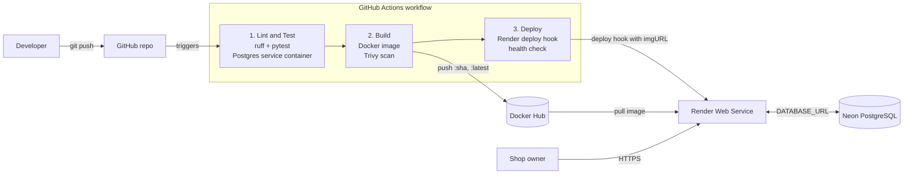

# StockFlow — Automated CI/CD Pipeline for a Containerized Inventory Management System

**Using GitHub Actions, Docker and Render**

DevOps Lab Mini Project · Batch 11
- Ashish Kumar (16010123084)
- Ashvatth Joshi (16010123085)
- Harsh Shah (16010123140)

StockFlow is a small inventory management web app (products, stock in/out, low-stock alerts, dashboard).
The focus of the project is the **pipeline**: every push to `main` is automatically linted, tested,
containerized, security-scanned, pushed to Docker Hub and deployed to Render — no manual steps.

---

## Architecture



| Stage | Tool | What happens | Runs on |
|---|---|---|---|
| Source | Git + GitHub | Code, Dockerfile, workflow all version-controlled | — |
| CI | GitHub Actions, ruff, pytest | Lint + 10 API tests against a throwaway PostgreSQL container | push + PR |
| Build | Docker (multi-stage), Buildx | Image tagged with commit SHA + `latest`, layer cache in GHA | push to `main` |
| Security | Trivy | Scans image for HIGH/CRITICAL CVEs (DevSecOps) | push to `main` |
| Registry | Docker Hub | Stores versioned images | push to `main` |
| CD | Render deploy hook | Render pulls the exact SHA-tagged image | push to `main` |
| Verify | curl `/health` | Pipeline waits until live `/health` reports the new commit SHA | push to `main` |

Failures stop the pipeline: if a test fails, no image is built and nothing is deployed.

## Tech stack

- **App:** FastAPI (Python 3.12), SQLAlchemy 2, plain HTML/JS frontend with precompiled Tailwind CSS
- **Database:** PostgreSQL 16 (local: Docker Compose, CI: service container, prod: Neon)
- **Container:** Docker multi-stage build, non-root user, `HEALTHCHECK`
- **CI/CD:** GitHub Actions (3 dependent jobs)
- **Hosting:** Render (free web service, Docker image)

## Project structure

```
stockflow/
├── app/
│   ├── main.py            # FastAPI routes
│   ├── models.py          # SQLAlchemy tables (products, stock_movements)
│   ├── schemas.py         # Pydantic request/response validation
│   ├── database.py        # DB engine from DATABASE_URL
│   └── static/            # index.html + styles.css (UI)
├── tests/                 # pytest suite (10 tests)
├── Dockerfile             # multi-stage, non-root
├── docker-compose.yml     # app + postgres for local dev
├── .github/workflows/ci-cd.yml
├── requirements.txt       # runtime deps
└── requirements-dev.txt   # + pytest, httpx, ruff
```

## API

| Method | Endpoint | Purpose |
|---|---|---|
| GET | `/health` | Liveness + DB check, returns deployed commit SHA |
| GET | `/api/products` | List products |
| POST | `/api/products` | Create product |
| GET / PUT / DELETE | `/api/products/{id}` | Read / update / delete |
| POST | `/api/products/{id}/stock` | Stock in (+) or out (−); rejects going below 0 |
| GET | `/api/products/{id}/movements` | Stock movement history |
| GET | `/api/products/low-stock` | Items below their minimum level |
| GET | `/api/stats` | Dashboard totals |

Interactive docs: `/docs` (Swagger UI).

---

## Run locally

**With Docker (recommended):**
```bash
docker compose up --build
# open http://localhost:8000
```

**Without Docker (uses SQLite):**
```bash
python -m venv .venv && source .venv/bin/activate      # Windows: .venv\Scripts\activate
pip install -r requirements-dev.txt
SEED_DATA=true uvicorn app.main:app --reload
```

**Run tests + lint:**
```bash
pytest -v
ruff check .
```

---

## One-time setup (pipeline + deployment)

### 1. Database: Neon
Create a free project at neon.tech, then copy the connection string (`postgresql://...?sslmode=require`).

### 2. Docker Hub
1. Create a **public** repository named `stockflow`.
2. Account Settings → Personal access tokens → generate a token with Read & Write access.

### 3. GitHub repo + secrets
```bash
git init && git add . && git commit -m "Initial commit: StockFlow"
git branch -M main
git remote add origin https://github.com/<you>/stockflow.git
```
Repo → Settings → Secrets and variables → Actions → add:

| Secret | Value |
|---|---|
| `DOCKERHUB_USERNAME` | your Docker Hub username |
| `DOCKERHUB_TOKEN` | the token from step 2 |

```bash
git push -u origin main
```
The first run tests, builds and pushes the image. Deploy is skipped with a warning because Render isn't set up yet.

### 4. Render
1. New → Web Service → **Existing image** → `docker.io/<dockerhub-user>/stockflow:latest`
2. Instance type: Free
3. Environment variables: `DATABASE_URL` = Neon string, `SEED_DATA` = `true`
4. Advanced → Health Check Path: `/health`
5. After it's live: Settings → **Deploy Hook** → copy the URL

### 5. Finish the GitHub secrets

| Secret | Value |
|---|---|
| `RENDER_DEPLOY_HOOK_URL` | the deploy hook URL |
| `RENDER_APP_URL` | e.g. `https://stockflow-xxxx.onrender.com` (no trailing slash) |

Push any change, and the whole pipeline now runs through to a verified deployment.

### 6. (Recommended) Branch protection
Settings → Branches → Add rule for `main` → require a pull request + require status check **Lint & Test** to pass.

---

## Demo script (viva)

1. Open the live Render URL. The footer shows the deployed commit SHA.
2. Make a visible change (e.g. edit the subtitle in `app/static/index.html`), then:
   ```bash
   git commit -am "Update subtitle" && git push
   ```
3. Show the **Actions** tab: Lint & Test → Build & Push → Deploy to Render.
4. Show the image tags on Docker Hub (commit SHA + latest).
5. Refresh the live site: new change, new SHA in the footer.
6. **Failure demo:** break a test (e.g. change `== 25` to `== 99` in `test_stock_in_and_out`) and push. CI goes red, and Build and Deploy are skipped, so production is untouched.

> Render's free tier sleeps after ~15 minutes of inactivity, and the first request takes 30–60s. Open the site a minute before the demo.

## Updating the CSS

`app/static/styles.css` is precompiled Tailwind, so the app has no CDN dependency at runtime. If you add new Tailwind classes to `index.html`, rebuild it:
```bash
npx tailwindcss@3.4.16 -i tailwind.input.css -o app/static/styles.css --content app/static/index.html --minify
```

## Syllabus mapping

| Course outcome | Where it appears |
|---|---|
| CO1: DevOps principles, CI/CD, version control | Git workflow, branch protection, PR checks |
| CO2: CI/CD pipelines | `.github/workflows/ci-cd.yml` (3 dependent jobs, triggers, secrets, artifacts) |
| CO3: Containerization with Docker | Multi-stage `Dockerfile`, `docker-compose.yml`, Docker Hub registry |
| CO4: Deployment | Automated Render deployment via deploy hook, environment config |
| CO5: Monitoring, troubleshooting, security | `/health` checks, Docker `HEALTHCHECK`, post-deploy verification, Trivy scan |
